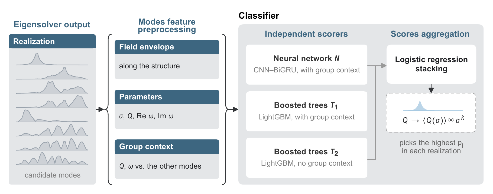

# Automated identification of quasi-BIC modes in disordered resonator chains using spatial field envelopes and resonance descriptors



[](https://arxiv.org/abs/2610.37967)
[](LICENSE)
[](https://doi.org/10.5281/zenodo.24168440)

[**Paper**](https://arxiv.org/abs/2610.37967) | [**Data**](https://doi.org/10.5281/zenodo.24168440) | **Model** (coming soon)

Code and data for *Automated identification of quasi-BIC modes in disordered resonator chains using spatial field
envelopes and resonance descriptors* (V. A. Porvatov, K. V. Semushev, R. Kh. Nazarov, N. A. Vlasov,
A. I. Solomonov, Z. F. Kondratenko, E. E. Maslova, [arXiv:2610.37967](https://arxiv.org/abs/2610.37967)).

Structural disorder turns a bound state in the continuum (BIC) into a quasi-BIC and mixes it with spectrally
close eigenmodes, so the target mode has to be found anew in every disorder realization. Every realization is
one *group* of candidate eigenmodes. Each candidate is described by the spatial envelope of its field along
the structure and by its resonance parameters ($Q$ factor, complex eigenfrequency). The classifier gives every
candidate a probability of being the target, and the candidate with the highest probability is selected.

## Overview

| Component | What it does |
|---|---|
| `data/download.py` | Downloads the published datasets from Zenodo and checks their MD5 sums |
| `preprocessing/build_dataset.py` | Builds a dataset from raw COMSOL eigenmode exports: field envelope, common grid, normalization, labels |
| `labels/*.csv` | The index of every dataset: one row per disorder realization, with the manual label |
| `model/` | The ensemble classifier (CNN–BiGRU + two LightGBM models + logistic stacking), coming soon |
| `tests/` | Unit tests for the preprocessing |

## Installation

Python 3.10 or newer.

```
git clone https://github.com/dyed-eye/quasi-bic-id.git
cd quasi-bic-id
pip install -r requirements.txt
```

## Data

```
python data/download.py --list     # files and sizes
python data/download.py            # everything into data/
python data/download.py disk_chain.npz  # one file
```

| File | Structure | Modes | Realizations | Labeled realizations |
|---|---|---|---|---|
| `disk_chain.npz` | chain of 50 ceramic disks, MQ quasi-BIC | 15,784 | 1,707 | all (1,503 with a target) |
| `gst_amorphous_lossless.npz` | GST bars, amorphous, lossless | 20,120 | 1,006 | 50 |
| `gst_crystalline_lossless.npz` | GST bars, crystalline, lossless | 20,200 | 1,010 | 50 |
| `gst_amorphous_lossy.npz` | GST bars, amorphous, lossy | 20,160 | 1,008 | 50 |
| `gst_crystalline_lossy.npz` | GST bars, crystalline, lossy | 15,150 | 1,010 | 50 |

Every file holds the same arrays. $E$ is the azimuthal electric field $E_\varphi$ for the chain and the magnetic field component
$H_y$ along the bar axis for GST.

| Key | Shape | Meaning |
|---|---|---|
| `E_abs` | `[N, 1883]` float32 | upper envelope of $\lvert E(z)\rvert$ along the inner line cut, divided by its own peak |
| `E_Re`, `E_Im` | `[N, 1883]` float32 | unsigned envelopes of $\operatorname{Re}E$ and $\operatorname{Im}E$, same divisor (chain: envelope of the signed part, clamped at 0; GST: envelope of $\lvert\operatorname{Re}E\rvert$, $\lvert\operatorname{Im}E\rvert$) |
| `norm_max` | `[N]` | the divisor: peak of the $\lvert E\rvert$ envelope in solver units (V/m for the chain, A/m for GST) |
| `meta` | `[N, 7]` | `sigma` (disorder, %), `quality` ($Q$), `freq_re`, `freq_im` (Hz), `meta_id` (mode index in its realization), `iter` (realization), `target` |
| `x_grid`, `dx` | `[1883]`, scalar | uniform grid along the structure, m (GST: each realization is stretched over the grid; `x_grid` uses the median structure length) |

Each realization has 8, 10 or 12 candidate modes in the chain, 20 in GST, and 15 in lossy crystalline GST.

`target` is 1 for the target mode and 0 for the other modes of a labeled realization. It is NaN when the
realization was not labeled. A labeled realization can have no target (all zeros) when the target could not
be identified unambiguously. A realization is a group of rows with the same `(sigma, iter)`.

The first 50 grid points are zero padding: the chain line cut starts at $z = 50$ mm, and the GST structure is
placed after 50 zeros so that both layouts match. `E_abs[:, 50:]` drops the padding.

For $\sigma \le 5$% the chain target is the highest-frequency mode of the MQ band, the band-edge standing wave. For
$\sigma \ge 6$% it was identified manually, see Section 2.3 of the paper.

```python
import numpy as np

d = np.load("data/disk_chain.npz")
sigma, quality, f_re, f_im, mode, it, target = d["meta"].T
group = (sigma == 6.0) & (it == 1)  # one disorder realization
print(quality[group], target[group])
```

## Rebuilding the datasets from raw exports

`build_dataset.py` turns the raw COMSOL exports into the files above. It reads one folder per realization:
the line cut (`cut1.txt` for the chain, `cutline_inside.txt` for GST, one complex column per mode) and
`out.txt` (complex eigenfrequency and Q of every mode). For each mode it:

1. takes the upper envelope of $|E|$, $\operatorname{Re}E$, $\operatorname{Im}E$ (straight lines between local maxima, no smoothing; the chain
   and GST recipes differ slightly, see the docstring at the top of `build_dataset.py`);
2. puts it on the common grid of 1883 points;
3. divides by the peak of the $|E|$ envelope;
4. attaches `meta` and the label from the index CSV.

```
python preprocessing/build_dataset.py chain RAW_DIR labels/disk_chain.csv data/disk_chain.npz
python preprocessing/build_dataset.py gst RAW_DIR labels/gst_crystalline_lossless.csv data/gst_crystalline_lossless.npz
```

The index CSV (`folder, sigma_pct, iter, target_mode`) lists the realizations in output order.
`target_mode` is the 0-based index of the target mode, `-1` means no identifiable target, and empty means not
labeled.

## Model

The training and inference code of the ensemble will be added to `model/`.

## Tests

```
pip install -r requirements.txt pytest
pytest -q
```

## Contact us

Questions about the code: open an issue. 

Corresponding author: Ekaterina E. Maslova,
ekaterina.maslova@metalab.ifmo.ru.

The work is funded by the Russian Science Foundation, grant No 26-72-10063. E. E. Maslova is grateful to the Priority 2030 Federal Academic Leadership Program.

## License

Code: GNU GPL v3, see [LICENSE](LICENSE). Data: CC BY 4.0 (Zenodo).

## Citation

```bibtex
@misc{porvatov2026quasibic,
  title         = {Automated identification of quasi-BIC modes in disordered resonator chains using spatial field envelopes and resonance descriptors},
  author        = {Porvatov, Vadim A. and Semushev, Kliment V. and Nazarov, Ravshanjon Kh. and Vlasov, Nikolai A. and Solomonov, Alexander I. and Kondratenko, Zarina F. and Maslova, Ekaterina E.},
  year          = {2026},
  eprint        = {2610.37967},
  archivePrefix = {arXiv}
}
```
